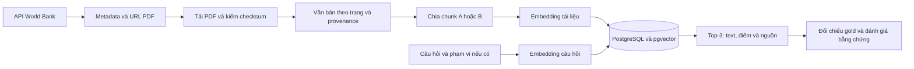

# Kiến trúc hệ thống truy xuất tài liệu

Hệ thống nhận câu hỏi, tìm ba đoạn văn bản có embedding gần nhất và trả về nội dung cùng nguồn, trang, metadata và điểm cosine. Pipeline gồm hai phần: chuẩn bị kho tài liệu và truy xuất để đánh giá. Dữ liệu dùng cho thực nghiệm là 39 trang thuộc chương 1–2 của báo cáo *2022 Vietnam Poverty & Equity Assessment* do World Bank xuất bản, tổng cộng 119.228 ký tự sau chuẩn hóa.

## Luồng xử lý

API Documents & Reports cung cấp thông tin tài liệu và liên kết PDF. Bản PDF có 232 trang; corpus chỉ lấy các trang nội dung đã ghi trong [manifest](../data/manifest.json). Giấy phép CC BY 3.0 IGO được kiểm tại trang PDF vật lý 3; nguồn và các thay đổi khi trích văn bản được ghi trong [ATTRIBUTION.md](../data/ATTRIBUTION.md). API và PDF được lấy qua HTTPS, không cần key.

Fetcher giới hạn worker, số tác vụ, tốc độ theo origin, response bytes và retry. Bản PDF phải khớp SHA-256 đã khai báo trước khi thay corpus. pypdf trích từng trang, sau đó chuẩn hóa Unicode NFC và khoảng trắng. Mỗi dòng trong [pages.jsonl](../data/pages.jsonl) là một trang với định danh tài liệu, URL, số trang vật lý và metadata. Trang in được lưu riêng vì không trùng số trang PDF.

## Chunk và nguồn gốc dữ liệu

Chunk là đơn vị văn bản được encode và xếp hạng. Chunk nhỏ làm giảm chi phí mỗi đầu vào nhưng dễ cắt đứt điều kiện, chủ thể hoặc phần giải thích; overlap tăng khả năng giữ đủ ý quanh biên nhưng làm tăng dữ liệu lưu và tính toán. Hai quy tắc được dùng trong bài:

| Cấu hình | Cách chia | Cách truy xuất |
|---|---|---|
| A | 300 ký tự, overlap 30 ký tự | Không filter |
| B | Ưu tiên ranh giới đoạn; đoạn dài cắt tại ranh giới từ, tối đa 300 ký tự; không overlap | Không filter |
| C | Chung chunk, vector và dữ liệu vật lý của B | Thêm filter khi câu hỏi/ngữ cảnh có phạm vi cung cấp trước |

A–B so sánh hai quy tắc chia đoạn, bao gồm cả khác biệt overlap. B–C chỉ thay bộ lọc. PDF plain không giữ dòng trống giữa đoạn trên 38/39 trang, nên B chủ yếu dùng cách cắt tại ranh giới từ. Nó không đại diện cho việc khôi phục đầy đủ cấu trúc đoạn của PDF.

Mỗi chunk giữ `char_start` và `char_end` trong văn bản trang đã chuẩn hóa. ID phụ thuộc nội dung, vị trí và cách chia để giữ ổn định khi chạy lại cùng đầu vào. Một kết quả có thể được kiểm bằng cách mở `source`, đến `page`, rồi đối chiếu đúng lát cắt `[char_start, char_end)`. Header, caption và một số lỗi khoảng trắng còn trong text được giữ như giới hạn của bước trích xuất, thay vì sửa tay sau khi đo.

## Embedding và cache

Embedding biểu diễn văn bản bằng vector số để so mức gần nhau về nội dung. Model sử dụng trong bài là `sentence-transformers/paraphrase-multilingual-MiniLM-L12-v2`, ghim revision `e8f8c211226b894fcb81acc59f3b34ba3efd5f42`. Model chạy local trên CPU, trả vector 384 chiều, kiểu float32 và được chuẩn hóa độ dài. Query và tài liệu dùng cùng model, không có bước gọi dịch vụ sinh câu trả lời.

Mỗi batch chứa tối đa 16 văn bản, với ngân sách 4 native threads. Pipeline đếm token trước encode; đầu vào quá giới hạn 128 token bị từ chối để vector không mô tả một văn bản đã bị cắt âm thầm. Các phép toán vector dùng ndarray và backend native. Cache lưu theo fingerprint của model, phiên bản, cấu hình, vai trò query/document và nội dung; checksum giúp phát hiện file hỏng. Khi evaluate, một query embedding được dùng chung cho A/B/C để giữ phép so sánh nhất quán.

## Lưu trữ và tìm kiếm

PostgreSQL là database duy nhất. Extension pgvector bổ sung kiểu vector và toán tử khoảng cách; metadata được lưu bằng JSONB. Hai bảng chính gồm:

| Bảng | Nội dung | Vai trò |
|---|---|---|
| `day6_chunks` | Chiến lược, chunk ID, text, document ID, source, page, metadata và embedding | Lưu bằng chứng để truy xuất và đối chiếu |
| `day6_indexes` | Fingerprint và số chunk của từng chiến lược | Kiểm index có khớp corpus/model/cấu hình trước evaluate |

Mỗi lần ingest thay toàn bộ dữ liệu của một chiến lược trong transaction. A được lưu riêng; B là dữ liệu dùng chung cho cả B và C. Nạp lại cùng corpus không nhân bản. Khi thay corpus, chunk cũ được loại trong cùng transaction. Nếu COPY lỗi giữa các batch, rollback giữ bản đã commit trước đó.

Database áp dụng filter JSONB trước khi xếp hạng theo cosine. pgvector dùng toán tử `<=>` cho khoảng cách; điểm trả về được tính bằng `1 - khoảng cách`. Truy xuất là exact search, lấy top-3 và dùng chunk ID để sắp ổn định khi bằng điểm. Với quy mô 459 chunk A và 421 chunk B, cấu hình này giúp so sánh trực tiếp mà không thêm sai số của approximate search.

Metadata gồm URL, trang PDF, trang in, chương, năm báo cáo, ngôn ngữ, loại và phiên bản tài liệu. `chapter` có hai giá trị chuỗi `"1"` và `"2"`, được xác minh từ mục lục. Ví dụ, khi người đọc đã chọn phạm vi chương 2, C dùng `{"chapter": "2"}`; không lấy chương từ đáp án chuẩn để tạo filter. Câu hỏi không có phạm vi thì C truy xuất giống B. Năm báo cáo 2022 được lưu riêng với ngày tài liệu do API ghi nhận là 10/04/2023.

## Thiết kế đánh giá

Bộ câu hỏi gồm 15 dev thuộc chương 1 và 5 test thuộc chương 2. Bốn câu có filter gồm q08, q14, q15 và q20; q20 thuộc test. Corpus, bộ câu hỏi, gold evidence, model và tham số được chốt trước khi retrieval. Các khái niệm có thể lặp lại giữa hai chương, vì vậy phép chia này vẫn có giới hạn về độc lập chủ đề.

Dev dùng để chọn cấu hình theo thứ tự Evidence Hit@3, Hit@1, số chunk ít hơn rồi A/B/C. Test kiểm tra cấu hình đã chọn với cùng fingerprint. A được chọn trên dev; kết quả test Evidence Hit@3 là 2/5 cho A và 1/5 cho B/C. Các kết quả này mô tả corpus hiện tại, không chứng minh cấu hình tối ưu cho mọi tài liệu.

Phép đo tự động yêu cầu một chunk đúng nguồn/trang và chứa đủ một gold evidence được chấp nhận. Cùng chủ đề hoặc cùng trang chưa đủ để tính hit. Coherence đo độ tự đủ của một chunk; grounding đo độ đủ bằng chứng trong cả top-3; metadata được kiểm về độ đúng, khả năng truy vết và tuân thủ filter. Vì các phép đo xét những khía cạnh khác nhau, grounding có thể tốt dù quote gold bị chia nhỏ và Hit@3 bằng 0. Bảng nhãn, trace và các trường hợp lỗi được phân tích trong [báo cáo](../report/individual/2A202603876_DinhPhucDien.md).

## Tổ chức mã và vận hành

| Thành phần | Tệp chính |
|---|---|
| CPU/RAM budget, telemetry, khóa tiến trình và ghi file nguyên tử | [runtime.py](../starter/src/runtime.py) |
| Thu thập HTTP, pacing, retry và snapshot cache | [fetching.py](../starter/src/fetching.py) |
| Đọc PDF/JSONL và chuẩn hóa | [ingestion.py](../starter/src/ingestion.py) |
| Chia đoạn, ID và offsets | [chunking.py](../starter/src/chunking.py) |
| Model thật và cache vector | [embeddings.py](../starter/src/embeddings.py) |
| COPY, transaction, filter và cosine search | [store.py](../starter/src/store.py) |
| Evidence metric và trace | [evaluation.py](../starter/src/evaluation.py) |
| Các lệnh preflight, fetch, validate, ingest và evaluate | [run.py](../starter/src/run.py) |

Ứng dụng dùng Python 3.12. Lựa chọn 1 là venv; lựa chọn 2 là Conda, được khuyến khích để quản lý phiên bản Python. [README](../README.md) cung cấp lệnh tạo môi trường, cài dependencies, khởi tạo PostgreSQL và chạy pipeline; [environment.json](../artifacts/environment.json) ghi phiên bản của lần thực nghiệm. Đường dẫn cấu hình tính từ gốc repository; output của mỗi lần chạy được lưu dưới `results/`.

Cơ chế kiểm soát lỗi, giới hạn tài nguyên và phạm vi test được mô tả trong [HARDENING.md](HARDENING.md). Các giới hạn quan trọng gồm RSS chỉ được kiểm ở ranh giới batch, số đo Python không bao gồm RAM PostgreSQL server và lỗi trích PDF có thể làm mất cấu trúc đoạn trước khi chunking. Những điểm này cần được tính đến khi giải thích cả chất lượng lẫn thời gian thực thi.
